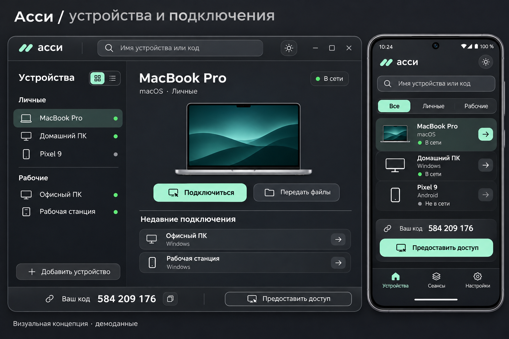

<div align="center">


**Удалённый доступ с ядром на Rust и спокойным, компактным интерфейсом.**

Windows · macOS · Linux · Android

[](https://github.com/LLC-INCY/assi/actions/workflows/build.yml)


[Возможности](#возможности) · [Платформы](#платформы) · [Сборка](#сборка-из-исходников) · [Документация](#документация)

</div>

<br />



<p align="center"><sub>Визуальная концепция с демонстрационными данными. Текущий интерфейс и набор функций могут отличаться.</sub></p>

## Ближе к своим устройствам

Подключиться к домашнему компьютеру, передать папку, показать нужное место на экране или работать с несколькими машинами — без перегруженной панели управления.

Асси объединяет Rust-ядро, нативные возможности ОС и интерфейс Tauri. Проект находится на стадии **early preview**: базовые сценарии реализованы, а поддержка функций различается между платформами. Это ещё не полный аналог RustDesk и не готовый промышленный релиз.

## Возможности

| | Что умеет Асси |
| :--- | :--- |
| **Экран и управление** | Трансляция экрана, выбор монитора, мышь, клавиатура, масштабирование и полноэкранный режим. Desktop-видео: программный H.264 с JPEG fallback. |
| **Совместная работа** | Пометки, видимые обоим участникам, чат и явная передача текста через буфер обмена. |
| **Файлы** | Очередь файлов, передача папок на desktop, пауза и продолжение в текущем соединении. Получатель подтверждает приём и распаковку. |
| **Несколько подключений** | Главное окно и до четырёх дополнительных desktop-окон с независимыми сеансами. |
| **Звук и запись** | Системный звук с macOS/Windows. Локальная запись видео без звука — при поддержке WebView. |
| **Инструменты** | Терминал macOS/Linux с отдельным разрешением. Блокировка и перезагрузка Windows/Linux с подтверждением владельца. |
| **Свои устройства** | Постоянный прямой доступ по секретному приглашению и автозапуск после входа в учётную запись на desktop. |

### Подключение без обязательного облака

Два устройства могут общаться **напрямую по TLS**, если между ними доступен сетевой адрес. Например, в локальной сети или через настроенную VPN. Для других сценариев есть собственный relay, который можно развернуть самостоятельно.

Публичного сервера Асси, поиска устройств по ID и автоматического обхода NAT пока нет. Приглашение содержит данные доступа — относитесь к нему как к паролю. Обычный входящий сеанс требует подтверждения; постоянный доступ включается владельцем отдельно.

> Версия 0.6 использует протокол **v4**. Обновите оба клиента и создайте новое приглашение.

## Платформы

| Платформа | Экран устройства | Управление устройством | Системный звук | Особенности |
| :--- | :---: | :---: | :---: | :--- |
| **Windows** | ✓ | ✓ | ✓ | Разрешения ОС и ограничения защищённого рабочего стола; UAC и экран входа не поддерживаются. |
| **macOS 13+** | ✓ | ✓ | ✓ | Для захвата и управления нужны системные разрешения. |
| **Linux** | ✓ | ✓* | — | Возможности зависят от графической сессии; Wayland требует отдельной проверки. |
| **Android 7+** | ✓ | — | — | MediaProjection с системным подтверждением. Без AccessibilityService, выбора папок через SAF и дополнительных окон. |

`✓` означает наличие реализации, а не завершённую проверку всех устройств. `*` Управление Linux зависит от доступного backend и окружения. Разрешения ОС, звук, задержка и поведение при отключении требуют проверки на физических устройствах.

### Автоматические сборки

GitHub Actions собирает пакеты для **Windows x64, Linux x64, macOS Apple Silicon и Intel, Android arm64**. Проверки и сборки запускаются на push в `main`, pull request и вручную. Артефакты можно скачать в завершённом запуске [Build](https://github.com/LLC-INCY/assi/actions/workflows/build.yml) в разделе **Artifacts** (нужен вход в GitHub).

Сборки для тестирования не имеют production-подписи или notarization; Android использует debug-подпись. Это не публикация в магазинах. Статус конкретной платформы смотрите в её job: наличие workflow само по себе не подтверждает успешную сборку.

## Сборка из исходников

Нужны **Rust 1.94+**, **Node.js 22+ / npm** и [системные зависимости Tauri 2](https://v2.tauri.app/start/prerequisites/). Для macOS также необходим Xcode/Swift toolchain; для Android — JDK и Android SDK/NDK.

```sh
npm ci
npm run dev
```

Desktop-сборка:

```sh
npm run build
```

Android arm64 APK — после настройки `JAVA_HOME`, `ANDROID_HOME` и `NDK_HOME`:

```sh
npm run android:init
npm run android:build
```

Проверки:

```sh
npm run ui:build
npm run check
```

Команды выполняются из корня репозитория. Полная инструкция: [DEVELOPMENT.md](DEVELOPMENT.md).

## Внутри проекта

```text
apps/client/          Tauri-клиент и интерфейс
apps/client/android-host/  Нативный Android MediaProjection plugin
crates/assi-session/  TLS-сеансы, протокол, файлы и права доступа
crates/assi-platform/ Захват экрана и системный ввод
crates/assi-video/    Видеокодирование
crates/assi-audio/    Системный звук
crates/assi-folders/  Потоковая упаковка и приём папок
crates/assi-access/   Постоянный доступ и автозапуск
crates/assi-terminal/ Терминальные сеансы
crates/assi-core/     Модель устройств и локальное хранилище
crates/assi-relay/    Самостоятельно разворачиваемый relay
```

## Что дальше

- Восстановление передачи файлов после полного разрыва связи.
- Аппаратное кодирование и адаптация качества к сети.
- Android SAF для выбора и сохранения файлов/папок.
- Системная служба до входа в учётную запись и дополнительные платформенные возможности.
- Проверки на реальных устройствах, подписанные пакеты и стабильные релизы.

## Документация

- [Что нового в 0.6 и известные ограничения](docs/IMPLEMENTATION-0.6.md)
- [Подключение двух устройств](docs/REMOTE-SESSIONS.md)
- [Инструменты сеанса](docs/SESSION-TOOLS.md)
- [Системный звук](docs/AUDIO.md)
- [Архитектура](ARCHITECTURE.md)
- [Разработка и сборка](DEVELOPMENT.md)
- [Проверки реализации](IMPLEMENTATION-VALIDATION.md)

## Участие и лицензия

Нашли проблему? Опишите ОС и версию приложения, шаги воспроизведения и ожидаемое поведение. Перед отправкой логов удалите приглашения, адреса устройств и другие личные данные. Не публикуйте данные доступа в issues.

**Доработка и бесплатное распространение разрешены. Продажа — только с разрешения правообладателя.**

Исходники опубликованы по [Assi No-Sale License 1.0](LICENSE). Ограничение продажи распространяется и на изменённые версии; это source-available проект, а не OSI open source. Полные условия — в `LICENSE`. Лицензии сторонних компонентов сохраняются; Manrope распространяется по [SIL Open Font License](prototype/assets/Manrope-OFL.txt).
